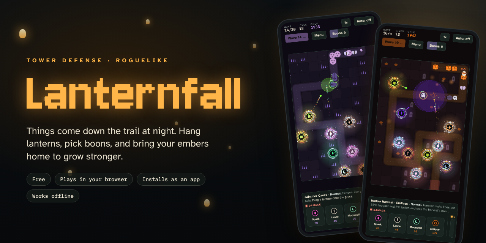
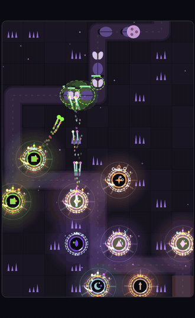
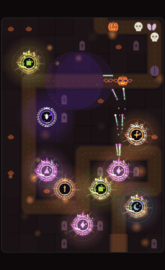
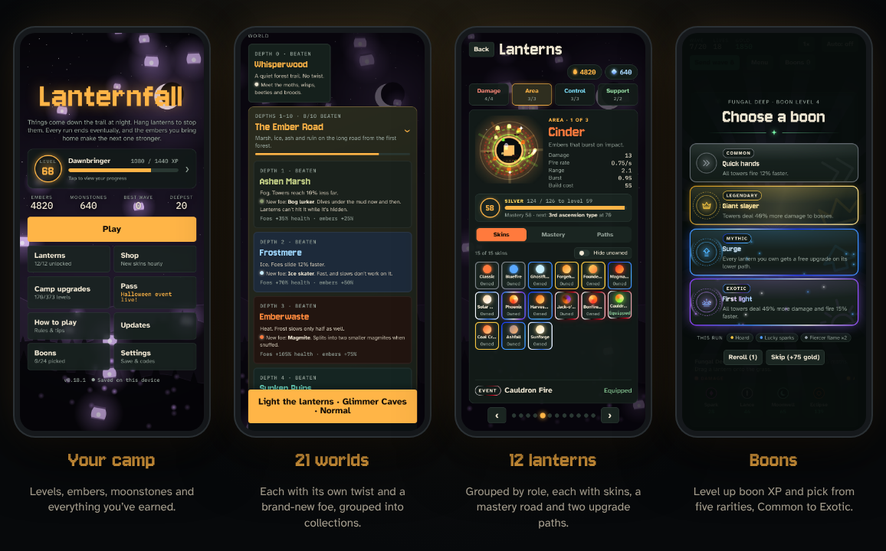
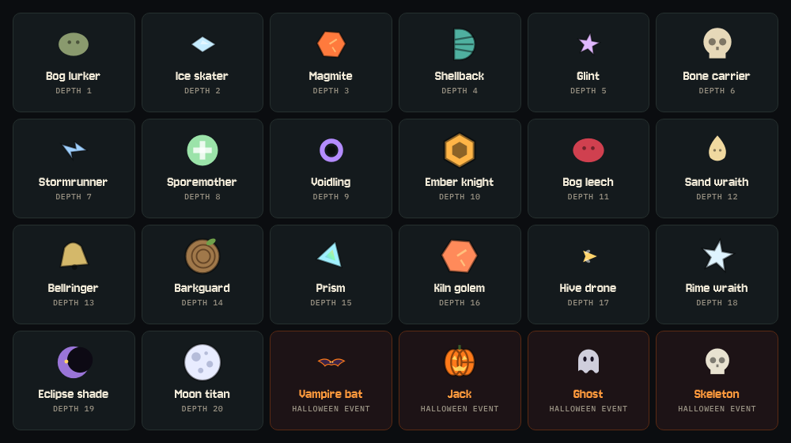
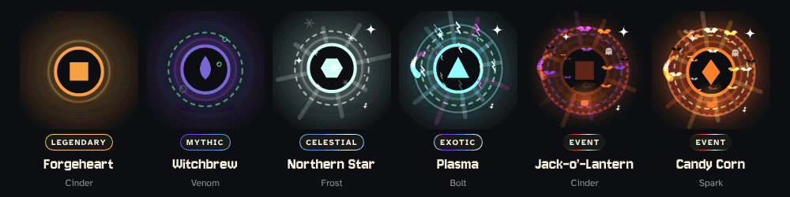
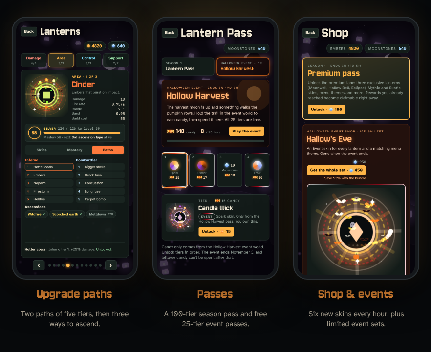
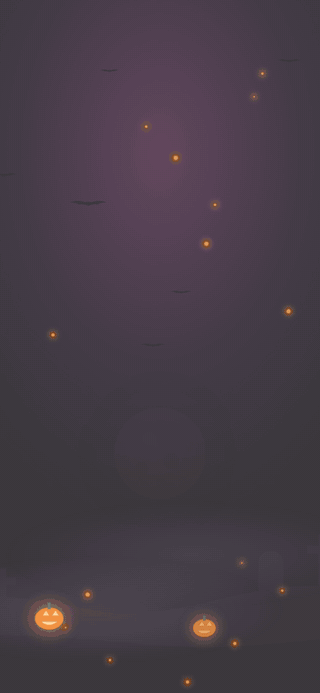

  

  
  
  

<h3 align="center">Build, upgrade and ascend your lanterns. Hold the trail through 21 worlds. Lose the night, keep your embers, and come back stronger.</h3>

  
  &nbsp;&nbsp;
  

---

## 🎃 Live now: the Hollow Harvest

The Halloween event runs until **November 1**. Pick it on the Play page for an endless, harder night with its own creatures: Vampire bats in flocks, Jacks that burst into seeds, Ghosts that fade out of reach, Skeletons that pull themselves back together, and the Pumpkin King every fifth wave.

Every wave you hold pays **candy**, which only drops here. Spend it on a **free 25-tier event pass** packed with Event skins, or pick up the **Hallow's Eve** set in the shop: an Event skin for every lantern and a matching menu theme.

---

## 🌙 1.0.5 (Oct 16, 2026)

- Fixed the empty strip under the game on iPhones when it is installed to the home screen. The game now fills the whole screen and keeps clear of the notch and home bar.

## 🌙 1.0.4 (Oct 16, 2026)

- A smoother difficulty curve: foes grow +21% a wave through wave 25, +19% to wave 30 and +14% after. Waves 6 to 25 are tougher, and there is no sudden wall at 26 to 30.
- Lantern path upgrades cost 15% more.

## 🌙 1.0.3 (Oct 16, 2026)

- Removed the Replay the tutorial button from Settings. The tutorial lives on the Play page.

## 🌙 1.0.2 (Oct 16, 2026)

- Leveling up is about twice as fast: level 100 takes about 55,000 XP, down from 107,000.
- Hollow Harvest foes scale from wave 10 instead of wave 30, and regular foes everywhere start their extra +10% a wave at wave 25.
- Gold is tighter: Gold rush gives 25% (was 40%), Scavenger 15% (was 25%), and Deep purse tops out at +15% (was +30%).

## 🌙 1.0.1 (Oct 16, 2026)

- **40-wave campaigns.** After wave 40, end the run or keep going until the lanterns go dark (×0.25 rewards past 40).
- **Shorter, harder waves.** Fewer, tougher foes, tighter spacing, a steeper last stretch and less gold per kill.
- **Snuffs and live mastery** in every lantern's upgrade sheet, and level and mastery bars in the run summary.
- **Auto** never sends wave 1. A tougher Season Pass curve, and a fix for waves that could stall.

## 🏮 Lanternfall 1.0 (Oct 15, 2026)

- **21 worlds, 21 bosses.** Every world has its own twist, its own foe and its own boss, down to the Moth Queen at the Hollow Moon.
- **12 lanterns, 53 boons.** Four roles, two upgrade paths each, ascensions and merges, and boons that change every run.
- **Campaign and Endless.** Hold 50 waves to unlock the next world, or go Endless through random worlds you've unlocked.
- **Grow between runs.** Camp upgrades, lantern mastery, a rank road to level 100 and Prestige up to X.
- **New player tutorial.** Play it any time from the Tutorial card on the world list.
- **Season 1 and Hollow Harvest** passes both end **November 1**.

## 👑 New in 0.21: Lords of the Night

- **21 world bosses.** Every world has its own boss with its own tricks, from the Elder Moth to the Moth Queen herself.
- **Boss health bar.** See each boss's name, title, shield and health at the top of the board.
- **Tutorial.** New players get a short guided first run.
- **Balance pass.** Gentler early bosses, more embers per run, and +20% embers and XP for every prestige.

## 🌟 New in 0.20: Prestige

- **Levels to 100.** Five new ranks, all the way to Eternal Flame.
- **Prestige.** At level 100, start the climb again for new rewards, up to Prestige X. Keep your moonstones, passes, skins and lanterns.
- **Prestige shop.** 20 Prestige skins, the most detailed in the game. They react when you tap them and when they fire.
- **Oblivion.** A new difficulty above Nightmare, unlocked by your first prestige.
- **Mastery prestige.** Reset a lantern from Mastery 100 to 1 for a permanent +2%, up to 10 times.

## 🌙 New in 0.19: The Wide Night

- **Landscape mode.** On computers, tablets and sideways phones the trail runs left to right, with your controls beside the board. Choose Auto, Portrait or Landscape in Settings.
- **Music.** Quiet, atmospheric tracks for every world and every menu theme, crossfading as you go.
- **Sound effects.** Soft menu sounds and a quiet voice for every lantern.
- **29 new boons, 53 in all.** Lantern boons only show up while that lantern is on the board.

---

## How a run works

1. **Pick a world and slide the difficulty.** Easy through Nightmare, then survive 50 waves. Harder nights pay up to ×2.25 embers and XP.
2. **Drag lanterns onto the grass.** Every run carves a brand-new random trail, so no two layouts play the same.
3. **Upgrade as the waves build.** Each lantern has two upgrade paths of five tiers. Max both and it can ascend, then merge with another ascended lantern for even more power.
4. **Earn boons.** Every foe you snuff and every upgrade you buy fills boon XP. Level it up to pick one of 53 boons, from Common and Rare up to Legendary, Mythic and Exotic.
5. **Bring your embers home.** Win or lose, the run pays out. Spend embers at camp on permanent upgrades and new lanterns, then go deeper.

---

## A whole night's worth of game

### 12 lanterns, each with real choices
Sparks, Cinders, Frost, Lances, Venom, Mints, Bolts, Beacons, Comets, plus three Season 1 lanterns: the Moonwell's burning beam, the Hollow Bell's freezing toll and the Eclipse. Lanterns are grouped into **Damage, Area, Control and Support**, and every one has:

- **Two upgrade paths, five tiers each.** 120 upgrades in all, from crits and armor piercing to burning ground and multi-shot.
- **Three ascension types** once both paths are maxed, and **merges** that forge Ascended II and III.
- **Mastery from 1 to 100.** Playing a lantern unlocks its later tiers and ascensions, plus a Radiant look at 100.

### 21 worlds, 24 kinds of foes
Every world has its own look and a rule twist: fog that shortens your range, ice that speeds foes up, swarms, plating, healing tides. Every depth also brings a **new foe with its own trick**.

Depths 1–10 make up **The Ember Road** and 11–20 are **The Deep Nights**. Or play **Endless**, where the world and its twist change every five waves while your trail stays put.

### Skins that get louder the rarer they are
Common, Rare, Legendary, Mythic, Celestial, Exotic, and limited **Event** skins. Legendaries gain a golden halo. Higher rarities add rune rings, light rays, orbiting sparkles and color-cycling shots. Event skins go further, with circling bats, drifting ghosts and a blood-moon glow.

### Passes, shop and progression
- **Season 1: The Hollow Moon.** A 100-tier pass with a story, three exclusive lanterns, Mythic and Exotic skins and menu themes.
- **Event passes.** Free 25-tier passes paid for with event currency.
- **Hourly shop.** Six featured skins rotate every hour, including 36 shop-only skins you can't get anywhere else.
- **67 camp upgrades with nearly 700 levels** across Economy, Offense, Defense, Run & boons, Lanterns, Lore and Progress.
- **Player levels, moonstones and redeem codes**, plus a stats page with your recent runs.

### Big updates arrive in style
Major updates play their own cinematic the first time you open the game, and you can replay any of them from the Updates page.

---

## Install it as an app

It's a full Progressive Web App: install it once and it runs full screen, works offline, and checks for updates on its own.

| Device | How |
|---|---|
| **iPhone / iPad** (Safari) | Open the link, tap **Share**, then **Add to Home Screen**. |
| **Android** (Chrome) | Open the link, then tap **Install app** (or menu ⋮ → **Add to Home screen**). |
| **Desktop** (Chrome / Edge) | Open the link and click the install icon in the address bar. |

**Play:** https://zhandermusic.github.io/lanternfall/

Plays upright on phones and in landscape on computers, tablets and phones turned sideways (switch any time in Settings), with atmospheric music for every world and menu theme and soft sound effects, each with its own volume and mute. On PC there are keyboard shortcuts: **Space** sends a wave, **1–9** pick lanterns, **U** upgrades, **M** merges, **F** changes speed, **P** pauses and **Esc** cancels.

## Docs

The **[Lanternfall docs](docs/README.md)** cover everything: [how to play](docs/how-to-play.md), a [strategy guide](docs/strategy.md), every [lantern](docs/lanterns.md), [foe](docs/foes.md), [world](docs/worlds.md), [boon](docs/boons.md) and [camp upgrade](docs/camp-upgrades.md), [how foes get tougher](docs/enemy-scaling.md), and [progression and rewards](docs/progression.md).

## Saves

Progress saves on your device automatically. Campaign, Endless and event runs all save between waves, so you can close the game mid-run and continue later. To move your progress between devices, use **Settings → Export save** and **Import save**.
